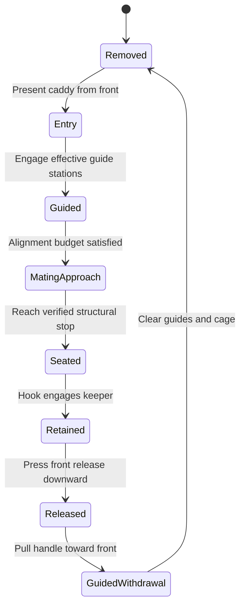

# SB35 — Single 3.5-inch HDD bay mechanism
## Engineering specification · fixed cage + removable caddy

**Revision:** 1.0, 13 September 2026  
**Parent:** Modular NAS tower CAD package v0.4, M30 storage module  
**Scope:** One mechanism only. Not an eight-bay row, a 2.5-inch variant, or a complete enclosure.  
**Implementation:** Claude Code/Fable through the actual Autodesk Fusion MCP bridge.  
**Specialist review:** GPT-6 Astra through `codex exec`, normally evidence-only.  
**Release state:** Development specification. No native CAD, printed fit, connector engagement, load capacity, or endurance has been validated by this document.

---

## 1. Purpose and precedence

Develop the **single functional seed bay** from which the tower's eight-drive 3.5-inch row can later be built. The output is a fixed, open cage and a removable drive-carrying caddy. They must work together as a guided insertion mechanism, not merely resemble NAS trays in a rendering.

Preserve the parent's 36 mm **candidate** pitch, vertical drive orientation, front service, simple pull handle, printed latch, and owner-modeled rear SATA coupler. A later change to pitch is possible, but must be documented rather than achieved by shrinking reference hardware.

This specification adds **proposed mechanical construction choices** to the parent's higher-level requirements. These choices are identified as C1 development candidates; they are not measurements, standards, or statements of owner approval. Use them to create study CAD and fit coupons. Record acceptance or replacement of C1 before releasing hardware-specific printable parts.

Authority order:

1. The owner's latest explicit decisions, including the manual coupler responsibility and mechanical-only capacity scope.
2. Applicable manufacturer drawings and standards for the actual hardware interface.
3. This single-bay specification for the scoped mechanism; parent v0.4 for tower integration.
4. An approved interface-control record and its associated parameter revision.
5. The modeling guide and task instructions.
6. Concept sketches, which are **not dimensioned evidence**.

A conflict becomes an issue with both source statements preserved. Do not resolve it by selecting whichever dimension makes the CAD easier.

### 1.1 Evidence labels

- **INHERITED:** Previously specified project behavior.
- **REFERENCE:** A source-bound standard or manufacturer example; applicability is limited.
- **CANDIDATE:** A new engineering choice for development, not a sourced fact.
- **DERIVED:** Computed from identified inputs and applicable only to them.
- **OWNER-INPUT:** Geometry or decision to be supplied by Andrej.
- **BLOCKED:** The dependent result cannot be released yet.
- **TESTED:** Reserved for an actual recorded test, configuration and acceptance criterion.

A null value is unknown. It is never zero and never permission to invent a default.

## 2. Required behavior and exclusions

### 2.1 User operation

A user shall be able to hold the handle, insert the caddy from the front, engage the guides, push it to a mechanical seated position, and retain it with a simple printed latch. Pressing the accessible release shall disengage the latch and permit straight front withdrawal. The drive remains screwed to the caddy during this operation.

The drive connects to the **stationary rear coupler** only after the guides establish alignment. The latch retains the tray; it is not a lever that forces the connector into place. Cables stay on the cage side when the tray is removed.

For this mechanical prototype, testing is de-energized and the disk is stationary. A functional mechanical connection does not establish live hot-swap suitability. PSU capacity is not a condition for creating the bay geometry.

### 2.2 Deliverable boundaries

**Included:** fixed cage structure, complementary guide surfaces, moving caddy, drive attachment, pull handle, replaceable printed latch candidate, keeper, mechanical stop, replaceable rear carrier architecture, reference hardware, movement envelopes, and fit-test articles.

**Excluded:** PSU, motherboard, tower columns, complete fan system, PCB backplane design, full eight-bay pattern, second drive size, electronic hot-swap qualification, powered performance certification, and photorealistic rendering work.

A rear airflow outlet and a tower attachment interface are required boundaries. Designing an entire fan module is not part of this task.

### 2.3 Requirement register

| ID | Requirement | Acceptance evidence |
|---|---|---|
| SB35-01 | Exactly one functional bay and one moving caddy in the production-intent branch. | Occurrence inventory and scope check. |
| SB35-02 | Drive stands on edge; rear connector faces +Y. | Native transform and oriented views. |
| SB35-03 | Straight front insertion/removal; neighboring bays need not move. | Travel check with neighboring keep-outs. |
| SB35-04 | Real drive outline, contacts, holes and fasteners retain their source dimensions. | Interface record and measured CAD landmarks. |
| SB35-05 | Caddy and cage are separate manufactured components/subassemblies. | BOM and body/component inspection. |
| SB35-06 | Guides constrain pose before connector contact. | Capture stages, angular budget and mating approach check. |
| SB35-07 | Simple handle plus finger-operated printed latch; no unsolicited cam lever. | Operation sequence and finger envelope. |
| SB35-08 | Latch release does not require accessing the rear or removing a neighboring tray. | Front access and release-motion check. |
| SB35-09 | Positive seating stop protects against overtravel; retained position preserves engagement. | Engagement interval and axial-backlash budget. |
| SB35-10 | Coupler stays on the fixed side and uses the owner's real interface. | Imported revision, transform and carrier attachment. |
| SB35-11 | Coupler can be replaced without destroying the cage. | Fastener/tool access and replacement sequence. |
| SB35-12 | Candidate 36 mm pitch compatibility is checked, not assumed. | Cell-bound and ±pitch neighbor-envelope measurements. |
| SB35-13 | Broad-face airflow paths are not replaced with continuous plastic walls. | Sections, channel geometry and intrusion budget. |
| SB35-14 | Drive screws use the applicable thread, locations and intrusion limits. | Worst-case fastener stack and assembly access. |
| SB35-15 | Latch flexibility/strength/endurance is not inferred from rigid-body motion. | Analytical screen plus physical test status. |
| SB35-16 | All manufactured parts are printable in the actual P1S profile. | Slicer/process record including supports and brim. |
| SB35-17 | Critical geometry remains parametrically driven and revision-linked. | Constraints, feature health and regression results. |
| SB35-18 | Unavailable inputs block only their dependent features. | Scoped blocker/dependency report. |
| SB35-19 | One live Fusion writer; specialist review uses a frozen evidence packet. | Writer/checkpoint and review records. |
| SB35-20 | Final claims distinguish study CAD, printable coupons, hardware fit and qualified operation. | Release declaration with unperformed tests. |

## 3. Source-bound reference data

Source standards are published on the [HomeStore overview page](/) (SFF-8301, SFF-8201 and related SFF specifications). Keep the source-native drawing available when generating mounting geometry; do not infer hole positions from a body outline.

| Reference quantity | Value | Scope |
|---|---:|---|
| SFF width | 101.60 ±0.25 mm | SFF-8301 rev. 1.9, Figure 3-1. |
| SFF maximum body length | 147.00 mm | Same source. |
| Thickness used in this packaging study | 26.11 mm maximum | IronWolf Pro manufacturer example; not a universal thickness. |
| Mounting thread | 6-32 UNC-2B | Standard reference; not M3. |
| SFF mounting penetration interval | 2.39–3.56 mm | Standard mounting interface, subject to selected hardware's applicable instructions. |
| Source-side hole station | 28.50 ±0.50 mm from rear datum | SFF A8. |
| Source-side hole separation | 101.60 ±0.25 mm | SFF A9. |
| Source-side hole height | 6.35 ±0.25 mm from the native bottom datum | SFF A10. |

The standard's middle side hole is optional. The chosen starting attachment is **two required side holes on each narrow mounting side**, avoiding reliance on the optional middle hole. The cited Seagate family permits four side screws. Its instructions and diagram must not be silently substituted for the SFF coordinate set: for example, the figure prints the rear side station in inches as 1.123 ±0.020, which is not an identical numeric transcription of SFF A8. Treat these as separate reference variants until the actual drive is identified. [S01, S02]

The source table is not a universal validated parts library. The owner's exact drive model remains pending. A generic body can establish packaging; a real drive mounting release needs its applicable interface.

## 4. Coordinates, datums and configuration states

### 4.1 Bay axes

Use the tower's right-handed orientation:

- **+X:** across the front toward the viewer's right.
- **+Y:** front to rear; insertion direction.
- **+Z:** upward.

Use a **functional bay origin** chosen to coincide with the reference drive's rear datum, native bottom datum and one narrow mounting side when seated. This is construction geometry owned by the cage assembly, not a moving edge or a cosmetic front surface.

### 4.2 Explicit reference transform

For the generic SFF reference define a native right-handed frame:

- `u`: body-width direction from the chosen narrow mounting side.
- `v`: front-to-rear direction; rear reference plane is `v=0`, body extends toward negative v.
- `w`: thickness direction from the native bottom datum.

Use this proper rotation, without reflection:

```text
X = -w
Y =  v
Z =  u

R = [ 0  0 -1 ]
    [ 0  1  0 ]       det(R) = +1
    [ 1  0  0 ]
```

Thus the study body occupies:

```text
X: -26.11 … 0 mm
Y: -147.00 … 0 mm
Z: 0 … 101.85 mm      [maximum outline; not the nominal hole plane]
```

This convention avoids centering an unknown drive around its thickness. The lower/upper side mounting holes map to the lower/upper narrow edges in the tower. Their axes are parallel to Z.

Check three noncollinear source landmarks and the actual SATA key orientation before accepting a real-part transform. A supplied model using another origin needs an explicit rigid transform. Never mirror or scale keyed hardware.

### 4.3 Generic side-hole landmarks

For **the SFF nominal reference only**, the four selected hole centers are:

| ID | X | Y | Z | Screw direction into drive |
|---|---:|---:|---:|---|
| LOWER_REAR | -6.35 | -28.50 | 0.00 | +Z |
| LOWER_FRONT | -6.35 | -130.10 | 0.00 | +Z |
| UPPER_REAR | -6.35 | -28.50 | 101.60 | -Z |
| UPPER_FRONT | -6.35 | -130.10 | 101.60 | -Z |

The forward station is `-(A8+A9)`, not a separately dimensioned edge offset. Preserve correlation and its source tolerance chain. Do not dimension hole Z from 101.85 mm merely because that is the maximum envelope width. The upper mounting surface belongs to the selected physical interface, not an arbitrary oversized box.

The accompanying CSV is a study-reference transcription, not a declaration of compatibility with every owner's drive.

### 4.4 Fixed and moving datums

| Datum | Owner | Function |
|---|---|---|
| BAY_ORIGIN / XY / XZ / YZ | Assembly | Common functional frame and source transform. |
| GUIDE_LOWER_BEARING | Cage | Primary vertical support for the sliding caddy. |
| GUIDE_X_LOCATOR | Cage | Primary lateral guide reference. |
| GUIDE_UPPER_KEEPER | Cage | Anti-lift/anti-roll boundary with defined relief. |
| CADDY_DRIVE_LOCATORS | Caddy | Actual drive attachment pads and hole planes. |
| CADDY_SEAT_SHOULDERS | Caddy | Structural contact at full insertion. |
| CAGE_SEAT_STOPS | Cage | Receives push load independently of electrical connector. |
| KEEPER_RETENTION_FACE | Cage | Resists caddy withdrawal when latched. |
| COUPLER_MATING_DATUM | Fixed carrier | Owner-defined electrical mating frame. |
| DRIVE_MATING_DATUM | Drive reference | Actual part's mating frame. |

Only one component owns each controlling datum. Copying an interface means linking/recording its revision, not redrawing the same measurement from a screenshot.

### 4.5 Service coordinate

Let **q be withdrawal distance**:

```text
q = 0                 nominal seated configuration
q > 0                 caddy withdrawn toward the front
caddy translation = (0, -q, 0)
```

CAD's internal joint value may use another sign or zero. Record the conversion; do not silently rename a reversed joint as correct.

## 5. Proposed mechanism C1

### 5.1 Architecture

Use an **open skeletal cage with lower and upper longitudinal guides**, and an **open caddy supported/fastened near the drive's narrow mounting edges**. The broad drive faces remain primarily exposed to air.

The front handle transfers push/pull loads into the caddy frame and its fasteners. The drive connector carries no intended structural load. The cage receives caddy weight through the lower guide. The upper guide prevents excessive lift/roll without over-constraining the running fit.

Use a **replaceable upper caddy strap** where needed to install the drive and reach the side screws. One caddy is a moving assembly, not a requirement to print everything as one brittle piece. A separate printed latch is likewise allowed and preferred for development.

```text
SB35_ASSEMBLY
├── DATUMS_AND_INTERFACE_GEOMETRY
├── FIXED_CAGE
│   ├── lower_guide_beam
│   ├── upper_guide_beam
│   ├── front_structural_bridge_and_keeper
│   ├── rear_structural_bridge
│   ├── mechanical_stop_features
│   └── replaceable_coupler_carrier [owner interface pending]
├── MOVING_CADDY
│   ├── lower_mounting_rail_and_front_handle_frame
│   ├── removable_upper_mounting_strap
│   ├── printed_latch
│   └── hardware [selected fasteners; nonprinted]
├── REFERENCE_DRIVE [not printed]
├── OWNER_COUPLER [not printed; absent until supplied]
└── ANALYSIS_ONLY
    ├── left_and_right_neighbor_keepouts
    ├── finger_and_driver_envelopes
    ├── airflow_and_motion_envelopes
    └── optional_bench_fixture_and_dummy_drive
```

Ground the fixed cage. Rigidly relate the caddy's structural pieces and mounted drive. The caddy gets one controlled prismatic motion for the service study. The latch's flexure is not modeled as a physically proven rigid slider.

### 5.2 Fixed cage

The cage shall contain its own structural connection between lower and upper guides. It must not depend on the inserted HDD to become rigid. Connect the guides with front/rear bridges located outside the permitted body/motion envelope. A rear bridge cannot pass through the connector/cable corridor.

Keep guide bearing surfaces away from support scars, seams, magnet pockets and cosmetic fillets. Make the entrance chamfer distinct from the running guide, so modifying the lead-in does not move the bearing datum.

Provide a replaceable rear carrier interface. Do not print guessed SATA-shaped socket geometry. Until the owner's coupler arrives, show the interface as pending and omit the purchased component—not as a dimensionally credible generic substitute.

A bench-test mounting foot may be wider than the future pitch cell only when separated, named `BENCH_ONLY`, and excluded from integration exports. It is not permission to make the repeating cage wider than the budget.

### 5.3 Caddy and drive attachment

Use the four approved narrow-side screw positions in the chosen drive variant. Mount the drive before installing the caddy in the cage. The fastener driver must reach both lower and upper screws during this sequence.

Locate the drive on small, identified structural contact pads. Do not squeeze a cover, compress the PCB, cover a breather opening, or treat any visible screw in the drive's cover as a mounting point. Keep source-defined component keep-outs intact.

The upper strap should assemble without forcing the drive body to flex between nominal and maximum width. Use an explicit fit/assembly allowance and a verified datum strategy rather than clamping a 101.85 mm box between arbitrary 101.60 mm walls.

Proposed load path:

```text
hand → handle/frame → mounting supports/fasteners → drive
                         ↓
                 caddy guide runners → cage → fixture/module
```

SATA friction may contribute incidental insertion/removal resistance, but shall not be used as the sole axial retention or a weight-bearing support.

### 5.4 Running guides

C1 uses a **lower rectangular runner in an open U guide** and a **more relieved upper keeper guide**. Lower bearing lands establish the loaded Z position. Opposing lower flanks bound lateral movement. The upper keeper arrests lift and limits roll; it must not become a second incompatible precision track.

Separate the following dimensions:

- Clearance on each lateral side; total lateral clearance is their sum.
- Loaded bearing contact, which is not an arbitrary symmetric air gap.
- Unloaded upper anti-lift clearance.
- Upper lateral relief relative to the lower master guide.
- Entrance capture width and length.
- Longitudinal distance between effective alignment stations.

The guide must progressively establish alignment **before first electrical contact**, including the worst combination of clearances and allowed approach angle. A ideal slider joint constrains motion mathematically; it does not demonstrate that these printed surfaces really do so.

Do not put undercut rail features into C1 merely to make it look like a drawer slide. Open, inspectable bearing geometry is the starting approach. Any change to a dovetail/T-guide requires a new clearance, printability and load-path review.

### 5.5 Handle and front access

Use a vertical front grip contained within the future pitch-cell width. Leave a finger access volume that works between adjacent handles. Place the push pad and release where fingers do not need to reach above the storage row or behind the cage.

The grip may be a rigid bridge or pull lip. Its usable opening, section and forward projection remain ergonomic design choices requiring approval/testing, not universal hand dimensions. Model a named finger envelope and inspect it against the two adjacent reference bays.

Do not route withdrawal force through the thin flexure beam. The handle and flexible release may sit next to each other, but they serve different load paths.

### 5.6 Printed latch

C1 uses a **top-front replaceable cantilever latch** attached to the moving caddy. Its flexure extends generally along Y. Pressing the accessible front release pad downward in **-Z** lowers an upward-facing hook out of the cage keeper. The user then pulls in **-Y**.

The insertion-leading surface is ramped so insertion can deflect the hook. The withdrawal-retaining surface should resist withdrawal rather than act as a self-releasing ramp. Show the actual contact normals and force direction in a section before claiming the mechanism locks.

Place a mechanical release-travel limiter on the rigid caddy structure. It limits downward flexure; it must not collide before the hook has cleared the keeper. The latch should return close to its relaxed shape when seated. Do not hold it at maximum release deflection to maintain engagement.

The latch geometry shall define:

1. Free length, width, thickness and root transition.
2. Root clamp/attachment, with all holes outside the flexing length.
3. Hook engagement in Z and axial retaining overlap in Y.
4. Release clearance and worst-case required deflection.
5. Travel-limiter position, pad access, and ramp contact.
6. Axial retention play after latching and its effect on connector engagement.
7. Replaceability and printing orientation.

Astra must review the latch/stop/connector interaction before hardware-specific release. Rigid alternate hook positions are useful illustrations, not an elastic simulation or endurance proof. Polymer snap-fit guidance is useful for analytical screening, but its molded-resin allowances are not automatically allowances for printed filament. [S03]

### 5.7 Mechanical stop and retention

Provide **structural stop shoulders**, preferably a symmetric pair outside the connector corridor, so pushing the caddy does not rotate it or push the connector beyond its permitted travel. Contact is between designated caddy and cage faces.

Keep three events separate: full electrical engagement, contact with the structural stop, and successful latch retention. Their permitted intervals must overlap. A tray that clicks while partially mated is unacceptable. A tray that mates only because the stop is compressed is also unacceptable.

For connector-free guide/latch prototypes, use a clearly named test stop. It must be replaced or revalidated against the owner's actual engagement range before connecting a real drive to the rear coupler.

### 5.8 Mechanism state sequence



For the connector-free test configuration, `MatingApproach` is only a geometric approach region; it is **not** a verified electrical-mating state. A bad approach, unexpected resistance or an early latch click is a failed transition, not a reason to push harder.

### 5.9 Logical development bill of materials

| Item | Quantity for this mechanism | Manufacture / status |
|---|---:|---|
| Lower cage guide structure | 1 | Printed candidate. |
| Upper cage keeper structure | 1 | Printed candidate. |
| Front and rear cage connections | 1 each | Printed or combined with connected cage pieces; source geometry remains separate. |
| Caddy lower structure/front handle | 1 assembly | Printed candidate, connected load path. |
| Removable upper caddy strap | 1 candidate | Printed; attachment details need selected hardware. |
| Replaceable latch | 1 | Separate printed coupon/part candidate. |
| Rear coupler carrier | 1 | Interface geometry pending owner model. |
| Drive | 1 reference / test item | Never a printable production part. |
| Drive mounting screws | 4 for selected side-mount approach | Applicable 6-32 hardware, length/heads/stack still selected separately. |
| Rear SATA coupler | 1 when supplied | Purchased part modeled by owner, never printed. |
| Other assembly fasteners | As defined by the approved joint design | No invented diameter, torque or insert specification. |

This is a logical BOM, not a forced body count. A cage connection can be integrated into a genuinely connected printable body. Record the manufacturing split and its hardware before assigning final part counts.

## 6. Coupler interface and tolerance closure

The owner will model the coupler manually. Do not ask the owner to choose a different connector merely to continue guide development. Request the model and interface record when this dependent stage is reached.

The minimum usable record includes its model units/revision, both mating faces, drive-side mating frame, attachment features, complete rear plug/cable bounds, engagement range, and any verified lateral/angular capture allowance. Geometry-only inputs may be enough for initial carrier CAD but are not a substitute for missing mechanical ratings.

### 6.1 Independent alignment chains

```text
Cage datums → carrier → coupler mating frame
Cage datums → guides → caddy → drive attachment → drive mating frame
```

These chains must coincide across source tolerance, printing, assembly play, structural distortion and any compliance. Improving a nominal CAD alignment does not remove the real chain.

### 6.2 Controlled compliance

A small floating carrier is an option, not a default numerical fact. Identify the allowed X/Z translation and angular movement, axial restraint, recentering behavior and harness strain relief. Slotted bolt holes used for assembly adjustment are not automatically a functioning floating mount after tightening.

Do not suspend the coupler loosely from its cables. Restrain the cable-side harness to the fixed cage while preserving access to its plugs. Avoid vibration isolation that permits the drive to move independently of a rigidly fixed coupler without accounting for that relative motion.

### 6.3 Alignment budget

For each relevant lateral axis, calculate a worst-case sum of independent error bounds. Record correlations and do not count the same rail play twice.

```text
E_axis = E_drive + E_attachment + E_caddy + E_guide
       + E_cage + E_carrier + E_coupler + E_distortion + E_angular

E_angular = lever_arm * tan(angle_bound)
```

The simplified two-station relation `angle ≈ atan(total_lateral_play / station_separation)` can screen a guide design. It does not establish the actual clearance distribution, loaded contact state or connector capture limit.

### 6.4 Axial engagement including latch play

Let `e0` be nominal insertion into the real connector at q=0. Let `a` be maximum withdrawal allowed by the latched keeper. Let `Eminus`, `Eplus` be directional stack bounds, and `s` additional stop compression/overtravel.

```text
e_min_retained = e0 - Eminus - a
e_max_pushed   = e0 + Eplus + s

require e_min_retained >= required_full_engagement
require e_max_pushed   <= permitted_maximum_engagement
```

All terms other than the formula are currently interface inputs. Do not use an invented SATA engagement distance. Also check the approach outside the fully mated state: lead-in collision and angled first contact can damage a connector even when both seated inequalities pass.

## 7. Candidate numbers for controlled development

These are **C1 proposals for a labeled study/coupon configuration**, not standards, proven print tolerances, or a production release. Hardware-specific geometry remains blocked where its input is unknown. The machine-readable register separates candidate values from null release values.

| Parameter | Starting value | Purpose / limitation |
|---|---:|---|
| Neighbor pitch | 36.00 mm | Parent packing candidate, not fixed cage outer width. |
| Bare reference thickness | 26.11 mm | Source-bound packaging example. |
| Body-face gap at that pitch | 9.89 mm | Arithmetic, not necessarily usable airflow. |
| Free-channel exploration minimum | 6.00 mm | Parent study allocation; not thermal qualification. |
| Lower guide coupon runner width | 8.00 mm | Candidate test cross-section. |
| Lower guide coupon runner height | 3.00 mm | Candidate test cross-section. |
| Lateral coupon clearances, each side | 0.20 / 0.30 / 0.40 mm | Test variants; no selected production fit. |
| Upper guide extra lateral relief | 0.20 mm per side beyond selected lower fit | Candidate to avoid competing tracks. |
| Upper anti-lift coupon clearance | 0.50 mm | Study value, not source tolerance. |
| Entrance taper length | 5.00 mm | Candidate; actual capture needs proof. |
| Entrance extra lateral opening | 1.00 mm per side | Candidate; distinguish from running gap. |
| Guide coupon floor/flank wall | 2.50 mm | Coupon construction only; does not size load-bearing cage. |
| Reference station separation | 100.00 mm | Analytical example, not guaranteed effective guide overlap. |
| Example distance from rear station to mating location | 20.00 mm | Analytical example only; owner interface changes it. |
| Latch coupon free length / width / thickness | 28 / 6 / 1.2 mm | Initial flexure coupon, not validated material design. |
| Latch coupon root radius | 1.2 mm | Candidate structural transition. |
| Nominal hook engagement / extra release clearance | 1.0 / 0.3 mm | Coupon development only. |
| Release deflection limiter | 1.5 mm | Must still exceed worst-case disengagement motion. |

At 0.30 mm per flank, an 8 mm runner needs an 8.60 mm groove for the nominal coupon. Record whether the printed groove shrinks and runner grows; do not compensate both by an undocumented global scale.

For the illustrative 0.60 mm total lateral play, 100 mm station separation and 20 mm lever arm:

```text
angle_screen = atan(0.60 / 100) ≈ 0.344 degrees
lateral_extension_at_connector ≈ 0.120 mm
```

This is **one contribution**, not the whole alignment budget and not a pass.

For an ideal, uniform rectangular cantilever with tip displacement δ, use a preliminary small-deflection screen:

```text
strain_root ≈ 3*t*δ / (2*L²)
F_tip ≈ E*b*t³*δ / (4*L³)
```

The candidate at δ=1.5 mm gives about **0.344% nominal root strain**. This excludes stress concentration, print anisotropy, temperature, creep, root compliance and contact effects. E and allowable repeated strain are unknown; no force or safety factor is approved. [S03]

The 0.2 mm nominal difference between the 1.3 mm disengagement example and 1.5 mm limiter is not a tolerance qualification. If worst-case release requires more than the limiter permits, revise the mechanism rather than forcing the latch.

## 8. Pitch and airflow integration boundary

Only one actual bay is modeled. Add **analysis-only** neighboring body/hardware envelopes at X offsets -36 and +36 mm to check reach, motion and possible intrusion. These are not additional production cages.

Using the local body interval `[-26.11, 0]`, the pitch-cell boundaries halfway through the bare gaps are:

```text
cell_left  = -26.11 - 9.89/2 = -31.055 mm
cell_right =          9.89/2 =   4.945 mm
cell_span  = 36.000 mm
```

They are integration limits, not instructions to fill the whole width with plastic. Cage material may extend above/below the drive body-height region while maintaining the cell bounds; broad-face channel intrusion is evaluated separately in that region.

The study can be located in the parent's M30 frame without changing native hardware: with cassette-left origin and first drive-body lower X at 8 mm, use `t_x = 8 + 26.11 = 34.11 mm` for this seed. A later array would add `i * pitch` to that translation. This is the inherited **body-envelope study placement**, not a real connector datum. Y/Z placement and a real part's transformed bounds need their own interface record.

The single cell does **not** receive an 8 mm end wall on both sides. The parent's 8 mm end allocations apply once to the whole cassette, not to every repeated bay. Repeating oversized single-bay end walls would invalidate the row's width study.

At each relevant channel section:

```text
g_free_worst = pitch_min - body_thickness_max
             - left_intrusion_max - right_intrusion_max
```

Include screw heads, guides, ribs, distortion and tolerances once. A broad wall is not airflow. A source-mandated local mounting contact is not automatically the same as an open cooling surface; report where and why the flow channel changes.

Export measurements at the front mouth, forward guide station, mid-drive, rear guide station, connector corridor and rear outlet. Report open height/area and connectivity, not only a favorable minimum distance between two boxes. The final row's fan performance and temperature validation are outside this single-bay release.

## 9. Screw and assembly design

For each drive fastener identify the specific screw, head, washer, under-head length tolerance, caddy stack and drive intrusion.

```text
intrusion_min = screw_length_min - external_stack_max
intrusion_max = screw_length_max - external_stack_min
```

Compare to the applicable drive's limits. A numerical example with a 6.35 mm under-head length and a nominal 3.20 mm external stack yields 3.15 mm nominal intrusion; that arithmetic is **not a selected screw, approved stack or tolerance pass**.

Do not tap the drive screw into the printed clearance hole as a substitute for engaging the HDD thread. Do not choose M3 merely because other chassis hardware uses it. Do not assume all visible holes accept the same depth.

Separate the following assembly operations:

1. Place a stationary drive or test article into the lower caddy supports.
2. Install and locate the upper strap, when used.
3. Insert the approved four drive screws with complete driver access.
4. Install/verify latch and handle fasteners without contacting the drive PCB.
5. Fit the cage to its bench fixture/module attachment.
6. Install the real coupler carrier only when its interface is available.
7. Route/secure the rear cables on the fixed side.
8. Perform guided caddy insertion and verify latch/stop operation.

Reverse the sequence for service. Make sure a lower guide does not hide a drive screw before the caddy assembly is complete. A temporarily removable runner/strap is preferable to an inaccessible screw.

## 10. Manufacturing and maintenance

The printer is the owner's Bambu P1S. Its known nominal build envelope is not a guarantee for an arbitrary orientation, support structure or brim. Validate each part in the actual profile. A single mechanism is likely easier to segment than a full-width cage, but no part is declared printable merely from that observation.

Material and print process remain unselected. Do not automatically use an available PLA profile for a continuously warm loaded bay. Record the exact filament, conditioning, nozzle, layer height, extrusion widths, wall strategy, orientation and support contact areas before fit/load tests.

Print the latch separately so its long fibers/layers can be oriented intentionally and it can be replaced. Do not transfer molded-material snap-fit limits directly to an FDM beam. Guide coupons must use the same material, contact orientation and processing intended for the real guides.

Record hole corrections and post-processing as part of the process. Unrecorded sanding that makes one trial slide is not evidence that the original CAD tolerance is manufacturable. Remove debris before bringing prints near real drive connectors.

No lubricants, adhesives or elastomer isolators are implicitly selected. Their compatibility and effect on dimensions, creep, dust and connector alignment would need a separate choice.

## 11. Staged delivery and blockers

| Stage | Can proceed now? | Boundary |
|---|---|---|
| Source/native datum plan and one reference body | Yes | Labeled reference, not actual owner's drive. |
| Cage/caddy layout and pitch-cell study | Yes | C1 choices remain proposed. |
| Separate rail and latch coupon design | Yes | Printable coupon release needs process/owner test approval. |
| Full drive-specific attachment | Only with applicable interface | Generic SFF study can precede it. |
| Carrier architecture | Yes | Actual coupler cuts and installed transform pending. |
| Connector engagement, seated-stop and retained-depth release | No | Requires owner's mating interface and tolerance data. |
| Real drive fit/load/endurance claim | No | Requires recorded physical tests. |
| Later eight-bay integration | Not in this task | Seed evidence transferred to M30 after review. |

Do not repeatedly request deferred Fujitsu dimensions: they are irrelevant to this seed mechanism. Do not delay guide coupons because a PSU model is unavailable. Do not claim a generic connector solid unblocks the real mating interface.

## 12. Expected final package from Claude

Produce the native editable Fusion assembly, separate approved manufactured-part exports, source/parameter/interface records, an exploded assembly/service guide, a part and hardware list, measurements/constraint/health exports, motion results, coupon geometry, and review findings with correction evidence.

Use separate output directories for **study**, **coupon candidates**, and **hardware-specific prototype candidates**. Reference drives, neighbor envelopes, owner couplers, tools and air volumes are excluded from manufactured meshes.

Completion statement must name the configuration and state: what is modeled, what is measured in CAD, what has been physically tested, and exactly what remains blocked. The phrase “mechanism finished” must not conceal a pending coupler interface.
